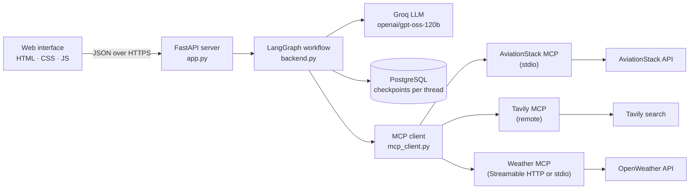
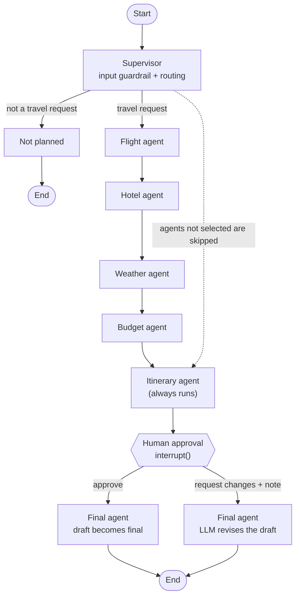

# SafrMrtah — AI Travel Intelligence Platform

> Describe a trip in your own words. A team of AI agents checks flights, hotels, weather and costs, drafts a day-by-day plan, and waits for **your** approval before it becomes final.

SafrMrtah is a multi-agent travel planner built with **LangGraph**, the **Model Context Protocol (MCP)** and **Groq**. A supervisor agent reads the request, validates it with an input guardrail, routes it to the specialist agents it needs, and pauses the workflow for a human decision (human-in-the-loop). Every step is checkpointed in **PostgreSQL**, so a plan survives a browser refresh, a server restart or a move to another machine.


---

## Contents

- [Why SafrMrtah](#why-safrmrtah)
- [Features](#features)
- [How it works](#how-it-works)
  - [Architecture](#architecture)
  - [Agent workflow](#agent-workflow)
  - [What each agent does](#what-each-agent-does)
  - [From request to final plan](#from-request-to-final-plan)
- [Tech stack](#tech-stack)
- [Project structure](#project-structure)
- [Getting started](#getting-started)
  - [Prerequisites](#prerequisites)
  - [API keys you need](#api-keys-you-need)
  - [Windows (one click)](#windows-one-click)
  - [macOS / Linux](#macos--linux)
- [Configuration](#configuration)
- [Using the app](#using-the-app)
- [API reference](#api-reference)
- [Deployment](#deployment)
- [Security](#security)
- [Troubleshooting](#troubleshooting)
- [Limitations and roadmap](#limitations-and-roadmap)
- [Documentation](#documentation)
- [Credits and license](#credits-and-license)
- [Author](#author)

---

## Why SafrMrtah

Planning a trip means jumping between airline sites, hotel listings, weather apps and a budget spreadsheet, then stitching it all into a daily plan. SafrMrtah does that coordination for you, and is built around three principles:

| Principle | What it means in practice |
|---|---|
| **Trust before polish** | The interface only shows what the agents actually returned. Missing values say *Not available*; prices are labelled as estimates; nothing is invented. |
| **A person has the last word** | Every plan stops at a draft. You approve it, or describe changes and the agents revise it. |
| **Plans are kept** | Each trip is a LangGraph thread stored in PostgreSQL, listed under *Your trips* and reloadable any time. |

## Features

**For travellers**
- Natural-language trip requests (“5 days from Dhaka to Dubai with flights, hotels and sightseeing”).
- Boarding-pass overview: route with airport codes, trip length, typical fare, flight time.
- Dedicated pages for **Flights**, **Hotels**, **Weather**, **Budget** and **Itinerary**, each showing only that topic for the selected trip.
- 5-day weather chart, budget breakdown chart, day cards with morning / afternoon / evening / transport.
- **Approve plan** or **Request changes** with a short note; the plan is revised from its saved checkpoint.
- Several trips side by side under *Your trips*; switch between them at any time.
- Copy the full plan or **download it as a PDF**.
- Responsive layout, keyboard focus, reduced-motion support.

**Under the hood**
- Supervisor routing: only the agents a request needs are run.
- LLM input guardrail that rejects requests that are not about travel.
- Live data through MCP servers: AviationStack (flights), Tavily (search), a custom OpenWeather server (weather).
- Remote weather MCP server over Streamable HTTP, with automatic fallback to a local one.
- Human-in-the-loop with LangGraph `interrupt()` and `Command(resume=…)`.
- PostgreSQL checkpointing plus read-only endpoints to list and reload trips.
- Optional password protection (HTTP Basic) for deployed servers.
- Production Docker image and a Render Blueprint.

## How it works

### Architecture



- The **browser** only talks to FastAPI.
- **FastAPI** runs the LangGraph workflow and serves the interface.
- **LangGraph** calls the Groq model and reaches external data through **MCP servers**.
- Every step is **checkpointed in PostgreSQL** under the trip’s `thread_id`.

### Agent workflow



The specialist agents run in a fixed order, and only those the supervisor selected. All agents share one state: the request, the extracted trip constraints, each agent’s result, the draft and the human decision.

### What each agent does

| Agent | Role | Data source |
|---|---|---|
| **Supervisor** | Runs the input guardrail (is this travel, is it safe?), selects agents, extracts trip constraints: origin, destination, duration, budget, style. The itinerary agent is always included. | Groq |
| **Flight agent** | Resolves departure and arrival airport codes, fetches future departure and arrival schedules, and writes flight guidance. Instructed not to invent prices or flight numbers. | Tavily → AviationStack → Groq |
| **Hotel agent** | Searches for hotels and areas to stay. | Tavily |
| **Weather agent** | Uses the supervisor’s destination to get current conditions and a 5-day daily forecast. | OpenWeather (weather MCP) |
| **Budget agent** | Estimates cost categories, risks, savings and feasibility. | Groq |
| **Itinerary agent** | Combines everything into a draft: summary, transport, accommodation, weather, day-by-day plan, budget, tips. | Groq |
| **Human approval** | Pauses the graph and waits for the traveller. | LangGraph `interrupt()` |
| **Final agent** | Approved → the draft becomes final. Changes requested → the draft is revised using the note. | Groq |

### From request to final plan

1. The interface sends `POST /api/travel` with a new thread.
2. LangGraph runs the supervisor, the selected agents and the itinerary agent, then stops at human approval. Each step is saved in PostgreSQL.
3. The server returns the draft and every agent’s result. A normalisation layer in the browser turns the text into structured pages, conservatively: airport codes only from labelled lines, prices only with a currency, totals either stated or clearly marked as “added up”. Anything missing shows *Not available*.
4. The traveller approves or requests changes; `POST /api/travel/approve` resumes the same thread from its checkpoint and returns the final plan.

## Tech stack

| Layer | Technology |
|---|---|
| Web server | FastAPI, Uvicorn, Jinja2 |
| Orchestration | LangGraph (state graph, `interrupt()`, PostgreSQL checkpointer) |
| Language model | Groq — `openai/gpt-oss-120b` via `langchain-groq` |
| Tool protocol | Model Context Protocol — `mcp`, `langchain-mcp-adapters` |
| Flight data | `aviationstack-mcp` (AviationStack API) |
| Web search | Tavily remote MCP server |
| Weather | Custom MCP server on OpenWeather (`custom_weather_mcp_server.py`) |
| Persistence | PostgreSQL (`psycopg`, `langgraph-checkpoint-postgres`) |
| Interface | HTML, CSS, vanilla JavaScript, Marked.js, html2pdf.js, Barlow font (bundled) |
| Tooling | `uv` (installs the AviationStack MCP tool) |
| Delivery | Docker, Render |

## Project structure

```text
.
├── app.py                         # FastAPI app: pages, API endpoints, optional password
├── backend.py                     # LangGraph workflow: supervisor, guardrail, agents, HITL
├── mcp_client.py                  # MCP connections (AviationStack, Tavily, Weather) + launchers
├── custom_weather_mcp_server.py   # Weather MCP server (OpenWeather), HTTP or stdio
├── templates/
│   └── index.html                 # Interface shell, icons, approval box
├── static/
│   ├── script.js                  # State, API calls, normalisation, rendering, sessions
│   ├── style.css                  # Design system (AviationStack palette)
│   └── fonts/                     # Barlow (SIL Open Font License)
├── docs/report/                   # Project report (PDF + LaTeX source)
├── requirements.txt
├── .env.example                   # Every setting, without values
├── setup_venv.bat                 # Windows: create .venv and install everything
├── run_local.bat                  # Windows: start weather server + app
├── Dockerfile                     # Production image
├── render.yaml                    # Render Blueprint
├── DEPLOY.md                      # Step-by-step deployment guide
└── LICENSE                        # Apache License 2.0
```

## Getting started

### Prerequisites

- **Python 3.11, 3.12 or 3.13**
- **Git**
- A **PostgreSQL** database (a free Render PostgreSQL instance works; use its *External Database URL*)
- Internet access on first setup (packages and the AviationStack MCP tool are downloaded)

### API keys you need

| Service | Used for | Variable |
|---|---|---|
| [Groq](https://console.groq.com/) | All LLM calls | `GROQ_API_KEY` |
| [Tavily](https://tavily.com/) | Airport lookup, hotel search | `TAVILY_API_KEY` |
| [AviationStack](https://aviationstack.com/) | Flight schedules | `AVIATIONSTACK_API_KEY` |
| [OpenWeather](https://openweathermap.org/api) | Weather | `OPENWEATHER_API_KEY` |
| PostgreSQL | Trip checkpoints | `DATABASE_URL` |

### Windows (one click)

```bat
git clone https://github.com/<your-username>/safrmrtah.git
cd safrmrtah
copy .env.example .env
```

Then:
1. Open `.env` and fill in your keys.
2. Run **`setup_venv.bat`** once: it creates `.venv` and installs everything.
3. Run **`run_local.bat`**: it starts the weather MCP server and the app.

Open **http://127.0.0.1:8000**.

`setup_venv.bat` finds Python 3.13, 3.12 or 3.11 on the machine, creates `.venv`, installs `requirements.txt` and installs the AviationStack MCP tool with `uv`.

> A virtual environment cannot be copied between computers. On a new machine, always run `setup_venv.bat` instead of copying `.venv`.

### macOS / Linux

```bash
git clone https://github.com/<your-username>/safrmrtah.git
cd safrmrtah
cp .env.example .env              # fill in your keys

python3 -m venv .venv
source .venv/bin/activate
pip install -r requirements.txt
uv tool install aviationstack-mcp # flight data MCP server

# optional: run the weather MCP server separately (remote mode)
python custom_weather_mcp_server.py &   # http://127.0.0.1:8001/mcp
# and add WEATHER_MCP_URL=http://127.0.0.1:8001/mcp to .env

python app.py                     # http://127.0.0.1:8000
```

## Configuration

All settings are environment variables, read from `.env` locally or from the host’s settings in production.

| Variable | Required | Default | Description |
|---|---|---|---|
| `GROQ_API_KEY` | yes | — | Groq API key |
| `DATABASE_URL` | yes | — | PostgreSQL URL. `sslmode=require` is added if missing (use `sslmode=disable` for a local database). |
| `TAVILY_API_KEY` | yes | — | Tavily API key |
| `AVIATIONSTACK_API_KEY` | yes | — | AviationStack API key |
| `OPENWEATHER_API_KEY` | yes | — | OpenWeather API key (for the weather server) |
| `APP_USERNAME` | no | `admin` | Sign-in username |
| `APP_PASSWORD` | on servers | empty | When set, the site asks for a password. Empty = open site (local use). |
| `WEATHER_MCP_URL` | no | — | URL of a separate weather MCP server, e.g. `http://127.0.0.1:8001/mcp` |
| `WEATHER_MCP_TOKEN` | no | — | Bearer token shared with the weather server |
| `WEATHER_MCP_LOCAL_FALLBACK` | no | `true` | Fall back to a local weather server if the remote one is down |
| `WEATHER_MCP_HOST` / `WEATHER_MCP_PORT` | no | `127.0.0.1` / `8001` | Where the weather server listens (`0.0.0.0` when deployed) |
| `AVIATIONSTACK_MCP_COMMAND` | no | auto | Custom command to start the AviationStack MCP server |
| `HOST` / `PORT` / `RELOAD` | no | `127.0.0.1` / `8000` / `true` | Local `python app.py` settings |

How the AviationStack MCP server is started (first match wins): the installed `aviationstack-mcp` tool, `uvx`, `python -m uv tool run`, then the `aviationstack_mcp` package. The startup log prints which one is used.

## Using the app

1. **Plan a trip.** On *Overview*, describe the trip — origin, destination, number of days and what to cover — or pick an example, then click **Plan this trip** (`Ctrl+Enter`).
2. **Read the overview.** Boarding pass, key figures, day-by-day preview, estimated costs and *What we checked*.
3. **Approve or request changes.** *Your plan is ready to check*: **Approve plan**, or write a note under *Anything to change?* and click **Request changes**.
4. **Explore each topic** from the sidebar: Flights, Hotels, Weather, Budget, Itinerary.
5. **Keep the plan.** *Full plan* → **Copy text** or **Download PDF**.
6. **Switch trips** under *Your trips*, or start another with **New trip**.

| Status | Meaning |
|---|---|
| Draft | Ready, waiting for your approval |
| Approved | You approved it; it is final |
| Updated | You requested changes and the plan was revised |
| Not planned | The request was not about travel |

**Tips for a good request:** name both cities, the number of days, and the topics you want (flights, hotel level, budget, activities). Topics you leave out are not planned. Fares and costs are estimates, and the forecast covers the next five days, not necessarily your travel dates.

## API reference

When `APP_PASSWORD` is set, add `-u admin:<password>` to every request except `/health`.

### `POST /api/travel` — start a plan

```bash
curl -X POST http://127.0.0.1:8000/api/travel \
  -H "Content-Type: application/json" \
  -d '{"message": "Plan 5 days from Dhaka to Dubai with flights, hotels and weather", "thread_id": null}'
```

Returns `thread_id`, `requires_approval`, `answer` (the draft), `itinerary`, `selected_agents`, `supervisor_reasoning`, `guardrail_allowed`, `trip_constraints`, and each agent’s result (`flight_results`, `hotel_results`, `weather_results`, `budget_results`).

### `POST /api/travel/approve` — approve or request changes

```bash
curl -X POST http://127.0.0.1:8000/api/travel/approve \
  -H "Content-Type: application/json" \
  -d '{"thread_id": "user_…", "approved": false, "feedback": "cheaper hotel, keep day 3 free"}'
```

`feedback` is required when `approved` is `false`.

### `GET /api/travel/sessions` — recent trips

Lists up to 30 trips stored in PostgreSQL (`?limit=` up to 100) with request, constraints, selected agents, status and dates.

### `GET /api/travel/session/{thread_id}` — one trip

Rebuilds a trip from its latest checkpoint, in the same shape as `POST /api/travel`, plus `status` (`draft`, `finalized`, `revised`, `completed`, `blocked`).

### `GET /health`

Health check. Always public.

## Deployment

See **[DEPLOY.md](DEPLOY.md)** for the full guide. In short:

**Render (recommended)**
1. Push the project to your own GitHub repository (`.env` stays local).
2. Render → **New → Blueprint** → select the repository. Render reads `render.yaml` and builds the `Dockerfile`.
3. Enter the API keys, `DATABASE_URL` and an `APP_PASSWORD`.

On the free plan the service sleeps after a period without visits and takes about a minute to wake.

**Any Docker host**

```bash
docker build -t safrmrtah .
docker run -p 8000:8000 --env-file .env -e APP_PASSWORD=choose-one safrmrtah
```

The image listens on `$PORT` (default 8000), runs as a non-root user, has a health check, installs the AviationStack MCP tool at build time, and never contains `.env`.

## Security

- **Password protection** (HTTP Basic) when `APP_PASSWORD` is set; `/health` stays public for the host’s checks.
- **Secrets** live only in `.env` (git-ignored, Docker-ignored) or the host’s settings.
- **Weather server** can require a bearer token (`WEATHER_MCP_TOKEN`).
- **AI output is sanitised** before display: scripts, event handlers and `javascript:` links are removed.
- **Scope:** everyone with the password sees all trips. The app is designed for one person or a small team.

## Troubleshooting

| Symptom | Cause and fix |
|---|---|
| `did not find executable at C:\Users\…\python.exe` | `.venv` was copied from another computer. Run `setup_venv.bat`. |
| `uvx was not found` / no flight data | The AviationStack MCP tool is not installed. Run `setup_venv.bat`, or `pip install uv` then `uv tool install aviationstack-mcp`. |
| “Live weather couldn’t be fetched” | Check `OPENWEATHER_API_KEY`. If `WEATHER_MCP_URL` is set, make sure the weather server is running (`run_local.bat` starts it). |
| `GROQ_API_KEY is missing` / `DATABASE_URL is missing` | `.env` is missing or incomplete. Copy `.env.example` and fill it in. |
| Browser keeps asking for a password | `APP_PASSWORD` is set; sign in with `APP_USERNAME` (default `admin`). |
| Old trips missing in a new browser | They reload from PostgreSQL; check `DATABASE_URL` points to the same database. |
| Deployed site slow on first visit | Render free plan waking up; use a paid plan to keep it always on. |

## Limitations and roadmap

**Current limitations**
- Fares and costs are LLM estimates, not bookable quotes.
- The weather forecast covers the next five days, not the travel dates.
- Flight schedules depend on the AviationStack plan; airport codes are resolved with Tavily because airport search is not available on every plan.
- One shared password; no individual user accounts.

**Roadmap**
- User accounts, so each person sees only their own trips.
- Structured (JSON) agent outputs instead of parsing text.
- Live fare and hotel price APIs; date-specific weather.
- Streaming progress per agent.
- Automated tests and plan-quality evaluation.

## Documentation

- **Project report and user guide (PDF):** [`docs/report/SafrMrtah_Report.pdf`](docs/report/SafrMrtah_Report.pdf)
- **Deployment guide:** [`DEPLOY.md`](DEPLOY.md)

## Credits and license

SafrMrtah is based on [entbappy/Multi-Agent-System-using-LangGraph-MCP-Supervisor-Guardrails-HITL](https://github.com/entbappy/Multi-Agent-System-using-LangGraph-MCP-Supervisor-Guardrails-HITL), released under the **Apache License 2.0** (see [`LICENSE`](LICENSE)).

This version is modified: new interface and SafrMrtah branding, remote weather MCP server, robust AviationStack launcher, session history endpoints, full agent results, password protection, Docker and Render deployment, and documentation.

Fonts: Barlow, SIL Open Font License. Icons adapted from Lucide (ISC License).

## Author

**Mohamed Makrani** — Data Scientist & AI Developer

[LinkedIn](https://www.linkedin.com/in/mohamed-makrani-b9bb0028b/) · [Email](mailto:makranimohamed46@gmail.com)
